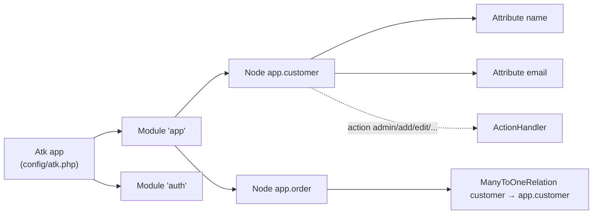

# Core concepts

[← Documentation index](../README.md)

An ATK application is a set of **modules**. A module registers **nodes**. A node is made of **attributes**, and **relations** are attributes that point to other nodes. Users work with a node through **actions** such as `admin`, `add`, `edit`, `view` and `delete`. Each action is executed by an **action handler**. This page explains each piece and how they fit together. The pages linked at the end of each section go into detail.



## Node

A node (`Core\Node`, [source](../../src/Core/Node.php)) describes one business entity, usually one database table. You subclass `Node`. In the constructor you set the table and add attributes. You can also set flags, ordering, a descriptor and filters. From that description ATK builds the paginated, searchable list (the `admin` action), the add, edit and view forms, and the delete confirmation. It also builds the SQL that loads and stores records.

Every node has a **node URI** of the form `module.nodename`, for example `app.customer`. The URI is the node's identity everywhere: in URLs (`atknodeuri=app.customer`), in privileges, in relation destinations, in translations and in the menu.

At runtime you obtain a node instance from the `Atk` singleton:

```php
use Sintattica\Atk\Core\Atk;

$customerNode = Atk::getInstance()->atkGetNode('app.customer');
```

`Atk::atkGetNode()` caches instances per request. It constructs the class registered for the URI with `new $class($nodeUri)` and then calls `Node::init()`. As a result, your node constructor receives exactly one argument, the node URI.

See [Nodes](nodes.md) and [Node hooks and overrides](node-hooks.md).

## Record

A record is a plain PHP associative array: attribute name ⇒ internal value. ATK passes records to almost every hook (`preAdd(array &$record)`, `rowColor(array $record)`, …). Besides attribute values, a record can carry a few framework keys:

| Key | Meaning |
|---|---|
| `atkprimkey` | The SQL condition that identifies the stored record, e.g. `customer.id='12'` |
| `atkerror` | A list of validation errors, filled by validation and by `Tools::triggerError()` |
| `atkorgrec` | The original record before an update. Only present when the node has `NF_TRACK_CHANGES` |

## Attribute

An attribute (`Attributes\Attribute`, [source](../../src/Attributes/Attribute.php)) maps one field of the record. It usually also maps one database column. The attribute decides:
- how its value is edited (`edit()`), displayed (`display()`) and searched (`search()`);
- how the value is validated (`validate()`);
- how the value is converted to and from the database (`value2db()` / `db2value()`).

Behaviour is tuned with **flags** (`AF_*` constants) that are OR-ed together, for example:

```php
use Sintattica\Atk\Attributes\Attribute as A;

$this->add(new A('name', A::AF_OBLIGATORY | A::AF_SEARCHABLE));
```

ATK ships about 60 specialised attributes (dates, numbers, lists, files, rich text, …). See [Attributes](attributes.md), the [attribute reference](attribute-reference.md) and the [attribute flags reference](../reference/attribute-flags.md).

## Relation

A relation (`Relations\Relation`, [source](../../src/Relations/Relation.php)) is an attribute that links the node to another node, called the *destination*. The destination is given by its node URI:
- `ManyToOneRelation`: a foreign key rendered as a dropdown or autocomplete.
- `OneToManyRelation`: an inline grid of detail records.
- The many-to-many family: link tables.

See [Relations](relations.md).

## Module

A module (`Core\Module`, [source](../../src/Core/Module.php)) groups related nodes. It is a class with a static `$module` name and a `register()` method. In `register()` it calls `registerNode()` for each node and declares that node's actions. Modules are listed in the `modules` key of the application configuration. They can also add menu items. See [Modules and menu](modules-and-menu.md).

## Action

An action is something a user does with a node. It is identified by a string that travels in the request as `atkaction`. The standard actions map to handler classes in [`src/Handlers/`](../../src/Handlers):

| Action | Handler | What it does |
|---|---|---|
| `admin` | `AdminHandler` | Paginated list with search, plus optional add form or link |
| `add` / `save` | `AddHandler` / `SaveHandler` | Show the add form / store a new record |
| `edit` / `update` | `EditHandler` / `UpdateHandler` | Show the edit form / store changes |
| `view` | `ViewHandler` | Read-only view |
| `delete` | `DeleteHandler` | Confirm and delete |
| `copy`, `editcopy` | `CopyHandler`, `EditcopyHandler` | Copy a record (`NF_COPY`, `NF_EDITAFTERCOPY`) |
| `search`, `smartsearch` | `SearchHandler`, `SmartSearchHandler` | Extended search |
| `select` | `SelectHandler` | Pick a record, used by relations |
| `export`, `import` | `ExportHandler`, `ImportHandler` | CSV export / import (`NF_EXPORT`, `NF_IMPORT`) |
| `multiupdate`, `multiselect` | `MultiupdateHandler`, `MultiselectHandler` | Multi-record operations |

The handler is chosen by naming convention: action `foo` → class `Handlers\FooHandler`. If no such class exists, the generic `ActionHandler` is used, and it calls a method `action_foo()` on your node. That is how you add a **custom action**:

```php
public function action_archive(ActionHandler $handler): void
{
    // ... do the work, then go back
    $this->redirect();
}
```

Privileges are checked per action. `Node::allowed($action)` is called before the handler runs. Some actions are mapped onto others for privilege purposes: `save`→`add`, `update`→`edit`, `search`→`admin`, and so on. See [Security](security.md).

## Action handler and overrides

Handlers call most of their building blocks through `ActionHandler::invoke($method, ...)`. If the node defines a method with the same name, the node's method is called instead, with the handler as its first argument. For example, defining `adminHeader(AdminHandler $handler)` on the node replaces the header of the list page. This "override by method name" mechanism is used throughout ATK. It also covers per-attribute methods such as `<attribute>_display()` and `<attribute>_validate()`. See [Node hooks and overrides](node-hooks.md) and, for internals, [Action handlers](../internals/handlers.md).

## Request in one paragraph

`public/index.php` creates `new Atk($environment, $basedir)` and calls `run()`. The constructor loads `.env` and the configuration, then registers the modules (which calls each module's `register()`). `run()` then:
1. starts the session;
2. authenticates the user through `Security\SecurityManager`;
3. builds the menu and boots the modules;
4. lets `Ui\IndexPage` dispatch the request to `atknodeuri` and `atkaction`.

The node's handler renders Smarty templates into the AdminLTE page. The full sequence is described in [Request lifecycle](../internals/request-lifecycle.md).

## Where things live in an application

The [atk-skeleton](https://github.com/Sintattica/atk-skeleton) project uses this layout:

```
.env                      # environment (see Configuration basics)
config/atk.php            # application configuration, merged over ATK defaults
languages/<lng>.php       # application-wide translations
public/index.php          # front controller
src/Menu.php              # menu class (extends Core\Menu\MenuBase)
src/Modules/<Name>/Module.php
src/Modules/<Name>/<Node>.php
src/Modules/<Name>/languages/<lng>.php
src/Modules/<Name>/templates/  # optional module templates
```

See [Installation](../getting-started/installation.md) and [Configuration basics](../getting-started/configuration-basics.md).
