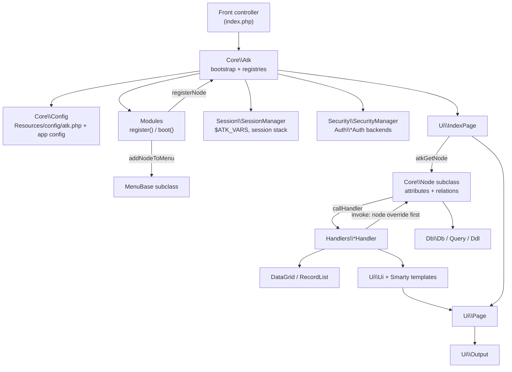

# Architecture

[← Documentation index](../README.md)

This page explains how ATK's source tree is organised and which long-lived objects make up a running application. For the step-by-step flow of a single request, see [Request lifecycle](request-lifecycle.md).

ATK is a Composer library, `sintattica/atk`. Its PSR-4 root is `Sintattica\Atk\` → [`src/`](../../src). An application depends on it and provides the following:
- a front controller, usually `index.php`;
- a `.env` file;
- `config/atk.php`;
- one or more modules, which register nodes.

## Source tree

| Directory | Namespace | Responsibility |
|---|---|---|
| [`Core/`](../../src/Core) | `Core` | Application kernel and data model. `Atk` handles bootstrap, the node and module registry, and handler registration. `Config` loads configuration. `Node` is the CRUD model and controller, with `DataNode` and `TreeNode` variants. Also contains `Module`, `Language`, `NodeValidator`, `Tools` (global helpers and error handlers) and `AdminLTE` (layout CSS classes). `Core/Menu/` holds the menu: `MenuBase`, `Menu` and the `Item` subclasses. |
| [`Attributes/`](../../src/Attributes) | `Attributes` | Field types. `Attribute` is the base class, plus about 60 subclasses and `NestedAttributes/`. |
| [`Relations/`](../../src/Relations) | `Relations` | Attributes that link nodes: many-to-one, one-to-many, one-to-one, many-to-many. |
| [`Handlers/`](../../src/Handlers) | `Handlers` | One `ActionHandler` subclass per action (`AdminHandler`, `AddHandler`, `SaveHandler`, …). |
| [`DataGrid/`](../../src/DataGrid) | `DataGrid` | The AJAX-capable list component used by admin and select pages. |
| [`RecordList/`](../../src/RecordList) | `RecordList` | Renders a set of records as HTML or CSV, plus totals and column configuration. |
| [`Db/`](../../src/Db) | `Db` | Database abstraction: `Db`, `Query`, `Ddl`, `Statement\*`, and the MySqli and PgSql drivers. See [Database layer](database-layer.md). |
| [`Session/`](../../src/Session) | `Session` | `SessionManager` (session stack), `State` and `SessionStore`. See [Session and state](session-and-state.md). |
| [`Security/`](../../src/Security) | `Security` | `SecurityManager`, the authentication backends in `Auth/`, `Encryption/`, the access logger, U2F, and the SQL where-clause blacklist. |
| [`Ui/`](../../src/Ui) | `Ui` | Rendering: `IndexPage` is the request front, then `Page`, `Ui`, `SmartyProvider`, `Output`, `PageBuilder` and `Footer`. `Ui/smarty-plugins/` holds the Smarty plugins. |
| [`Utils/`](../../src/Utils) | `Utils` | `Selector` (fluent record queries), `Debugger`, `StringParser`, `MessageQueue`, `EditFormModifier`, listeners, export and zip helpers. |
| [`Filters/`](../../src/Filters) | `Filters` | `Filter` attributes that modify the node query (`DistinctFilter`, `GroupByFilter`). |
| [`Errors/`](../../src/Errors) | `Errors` | Pluggable error reporters, selected with the `error_handlers` / `mailreport` config. |
| [`Cache/`](../../src/Cache) | `Cache` | Cache backends (Apc, Apcu, File, Memcache, Var). Not used by the framework itself; see [Known issues](known-issues.md#the-cache_method-default-breaks-cachegetinstance). |
| [`Listeners/`](../../src/Listeners) | `Listeners` | `RecycleBin` trigger listener. |
| [`AdminLte/`](../../src/AdminLte) | `AdminLte` | `UIStateColors` (Bootstrap state colour names). |
| [`Resources/`](../../src/Resources) | — | This directory is not PHP classes. It holds the default config (`config/atk.php`), the language files (`languages/*.php`), the Smarty templates (`templates/`), and the public assets (`public/`: AdminLTE, JS, libraries). The application serves `public/` at the `assets_url` config key. |

## Main objects at runtime

Most framework services are process-wide singletons reached through `getInstance()`:

| Object | Access | Notes |
|---|---|---|
| `Core\Atk` | `Atk::getInstance()` | Created once by the front controller. A second `new Atk()` throws. Holds the node class registry (`g_nodesClasses`), the security registry (`g_nodes`), module instances, node instances (`atkGetNode()` caches them per `cacheId`), and registered handlers. |
| `Core\Config` | static | `Config::getGlobal()`/`setGlobal()` for `atk.php` keys, and `Config::get($section, $tag)` for other config files. |
| `Session\SessionManager` | `getInstance()` | Starts the PHP session and builds `$ATK_VARS`. |
| `Security\SecurityManager` | `getInstance()` | Authentication, the current user and `allowed()` checks. |
| `Core\Menu\MenuBase` subclass | `<config menu>::getInstance()` | Filled by modules. |
| `Ui\Page` | `getInstance()` | Accumulates content, scripts, styles and hidden vars for the response. |
| `Ui\Ui` / `Ui\SmartyProvider` | `getInstance()` | Template rendering. There is one shared `Smarty` instance. |
| `Ui\Output` | `getInstance()` | Sends headers and the final body, including debugger output and gzip. |
| `Db\Db` | `Db::getInstance($conn)` | One instance per named connection. |
| `Utils\Debugger`, `Core\Language`, `Core\AdminLTE`, `Ui\Footer`, `Utils\MessageQueue` | `getInstance()` | Supporting services. |

Request input is not wrapped in an object. `SessionManager::start()` merges it into the global array **`$ATK_VARS`**, which is then copied into `Node::$m_postvars` and `ActionHandler::$m_postvars`.

## How the pieces fit together

## Key design points

- **Nodes are both model and controller.** A `Node` describes a table through its attributes, and also exposes the overridable page methods (`adminPage`, `editPage`, …) that the handlers call. `ActionHandler::invoke()` makes this work: it calls a method on the node if one exists, otherwise on the handler. See [Action handlers](handlers.md).
- **Node URIs** are `module.type` strings, e.g. `app.employee`. `Tools::getNodeModule()` and `Tools::getNodeType()` split them. Modules map URIs to classes with `Atk::registerNode()`. Only nodes registered *with actions* appear in the security registry `g_nodes`.
- **Configuration is plain PHP arrays.**
  - `Config::init()` loads the defaults, then merges the application file named by `application_config` into them with `Tools::atk_array_merge_recursive`.
  - `Config::get($section, ...)` reads `<application_config_dir>/<section>.php`. If `$section` is a module name, it also merges that module's own `config/<section>.php`.
- **No dependency injection container.** Collaborators are reached through singletons and globals (`$ATK_VARS`, `$g_error_msg`, `$g_debug_msg`, `$g_stickyurl`), so a request is effectively single-tenant.
- **Rendering is server-side Smarty.** JavaScript (`ATK.*` in `Resources/public/javascript`) adds partial updates. These go through the same dispatcher, with the `atkpartial` request variable.

## Related pages

- [Request lifecycle](request-lifecycle.md)
- [Action handlers](handlers.md)
- [Session and state](session-and-state.md)
- [Database layer](database-layer.md)
- [Core concepts](../guide/concepts.md)
