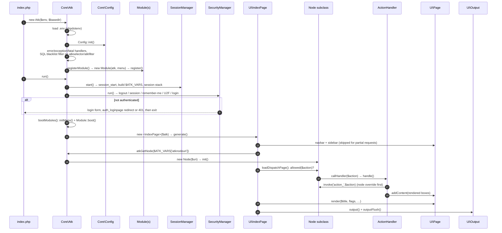

# Request lifecycle

[← Documentation index](../README.md)

This page follows one HTTP request from the front controller to the bytes sent to the browser. It is written for maintainers who need to know where to hook in, or why something happens in a particular order.

A typical front controller (see the `atk-skeleton` project) is:

```php
require __DIR__.'/../vendor/autoload.php';

$atk = new Sintattica\Atk\Core\Atk(getenv('APP_ENV'), __DIR__.'/../');
$atk->run();
```

## Overview



## 1. Construction: `Core\Atk::__construct($environment, $basedir)`

1. **Singleton guard.** If `Atk::$s_instance` is already set, a `RuntimeException` is thrown.
2. **`.env`.** If `<basedir>.env` exists, it is loaded with `Dotenv::createImmutable($basedir)`. Otherwise the request `die()`s. Values land in `$_ENV`/`$_SERVER`, not in `getenv()`. See [Known issues](known-issues.md#environment-variables-from-env-are-not-visible-to-configenv).
   - `$basedir` must end with a slash, because the path is built by plain concatenation.
3. **`Config::init()`.**
   - Loads `src/Resources/config/atk.php`. Keys that were already set with `Config::setGlobal()` before this point are kept.
   - Then merges the file at the `application_config` key recursively. The default is `<application_config_dir>/atk.php`.
4. **Error handling.**
   - With `debug > 0`, `display_errors` is enabled.
   - With `use_atkerrorhandler` (default `true`), ATK installs three handlers: `Tools::atkErrorHandler` (error), `Tools::atkExceptionHandler` (exception) and `Tools::atkFatalHandler` (shutdown).
   - Warnings are routed to `Tools::atkerror()`, which may throw when `throw_exception_on_error` is set. Other errors return HTTP 500 and halt.
5. **Request sanitising.** `SqlWhereclauseBlacklistChecker::filter_request_where_clause()` filters `atkselector` and `atkfilter`.
6. **Locale.** `setlocale(LC_TIME, …)` is called with the `locale` translation key.
7. **Module registration.** For every class in the `modules` config key, `Atk::registerModule()` does the following:
   - reads its static `$module` name;
   - instantiates it as `new $class($atk, $menu)`, where `$menu` is the configured menu singleton;
   - calls `register()`.

   This happens **before** the session and authentication. `register()` must therefore only declare things (`registerNode`, …) and must not depend on the current user.
8. **Access logger.** `AccessLoggerServiceProvider::register()` attaches the access logger when `auth_accesslog_enabled` is set.

## 2. `Atk::run()`

1. **`SessionManager::start()`.** It returns early on the CLI.
   - Reads `atklevel`, `atkprevlevel` and `atkstackid` from the request.
   - Configures the cookie and cache limiter, validates the session id, and calls `session_start()` under `session_name` (or `identifier`).
   - Builds `$ATK_VARS = array_merge($_GET, $_POST)`, decodes it (`Tools::atkDataDecode`) and injects `$_FILES`. If `atkfieldprefix` is set, it narrows `$ATK_VARS` to that sub-array.
   - Applies the global and stack scopes (`session_read`).
   - Handles the `atkescape`, `atknested` and `atkback` redirects.

   See [Session and state](session-and-state.md).
2. **Session keep-alive.** If `session_autorefresh` is on and the `session_autorefresh_key` GET parameter is present, the session id is printed and the request ends.
3. **`SecurityManager::run()`.**
   - Handles `atklogout` (log out, redirect, `exit`).
   - Otherwise tries, in order: the existing session login, remember-me, U2F, then form or HTTP-basic credentials.
   - If no user results, it renders the login form, redirects to `auth_loginpage` or sends a `401`, then **exits**.
   - On success it calls `postLogin()` and sets `$session['login'] = 1`.
4. If authenticated:
   - `bootModules()` calls `initMenu()`, which runs `appendMenuItems()` on the menu class. It then calls `boot()` on every module. Menu items and anything that depends on the user belong in `boot()`.
   - The class named by the `indexPage` config key (default `Ui\IndexPage`) is instantiated. `default_destination` is passed to it if it is an array, and `generate()` is called.

`Atk::runCli()` is the CLI variant. It forces `authentication` and `authorization` to `none`, runs the security manager, and boots the modules. It does not render.

## 3. `Ui\IndexPage::generate()`

1. **Page mode.** The constructor sets the page flags: `Page::HTML_PARTIAL` if `atkpartial` is present in `$ATK_VARS`, otherwise `Page::HTML_STRICT`.
2. **Chrome (non-partial only).** It adds the user and logout navbar links (`menu_show_user`, `menu_show_logout_link`). It then renders `menu/navbar.tpl` (or `navbar_without_sidebar.tpl` when `menu_hide_sidebar` is set) and `menu/sidebar.tpl` from `MenuBase::getMenu()`, with AdminLTE classes from `Core\AdminLTE`. Finally it registers the session auto-refresh JavaScript.
3. **`atkGenerateDispatcher()`.**
   - If the session is not logged in, it renders the "session expired" box.
   - Otherwise, if `atknodeuri` is set, it gets the node with `Atk::atkGetNode()` and calls `loadDispatchPage()`.
   - If there is no node URI, it redirects to `default_destination` or renders the index box (`app_shorttitle` / `app_description`).
4. **`loadDispatchPage($postvars, $node)`.**
   - Copies the request into `$node->m_postvars`, `m_action` and `m_partial`, and sets the page title.
   - **Authorisation gate:** checks `$node->allowed($action)`. If it fails, it renders the access-denied page.
   - If it passes, it logs the action through `SecurityManager::logAction()` and calls `$node->callHandler($action)`.
   - Registers the hidden vars `atknodeuri` and `atkselector` for client scripts.
5. **Render.** `Page::render()` wraps the accumulated content in `page.tpl`, then `layout.tpl`, including the `<head>` with all registered scripts and styles. In partial mode, `Page::renderPartial()` returns only the content plus the scripts and styles registered during the request.
6. **Output.** `Output::output()` buffers the HTML. `Output::outputFlush()` does the following:
   - sends the caching and `Content-Type` headers (charset from `Tools::atkGetCharset()`);
   - appends `Debugger::renderDebugAndErrorMessages()`;
   - optionally gzips the result (`output_gzip`).

## 4. Inside the node: `Node::callHandler($action)`

Node construction (`Atk::newAtkNode()`) calls `new $class($nodeUri)` and then `Node::init()`. `init()` sets the attribute owners, sorts the attributes, calls `postInit` on them, and runs the node's set-up hooks (filters, row colours, legend, admin header).

`callHandler()` looks up a handler registered for the node URI, or for `*`, with `Atk::atkGetNodeHandler()`. If none is registered, it uses `Node::getHandler()` → `ActionHandler::getDefaultHandler($action)`, which maps `edit` to `Handlers\EditHandler`, and so on. It then calls `handle()`.

`ActionHandler::handle()` calls `invoke('action_'.$action)`. Every page method (`adminPage`, `editPage`, `addPage`, …) is looked up the same way: on the node first, then on the handler. The details, including partials and CSRF, are in [Action handlers](handlers.md).

A write action (`save` or `update`) runs this sequence:
1. collect the record from the request (`Node::updateRecord()`);
2. check `allowed($record)` and the CSRF token;
3. run the `preAdd` or `preUpdate` trigger;
4. run `validate()`;
5. call `addDb()` or `updateDb()`;
6. commit (`Db::commit()`);
7. call `notify()`, clear the record-list cache, and redirect (`Node::redirect()` to the feedback or return URL).

On error the sequence rolls back. The MySqli driver turns autocommit off when it connects, so **anything a request does not explicitly commit is rolled back** when the connection closes.

## Where to hook in

| Need | Place |
|---|---|
| Declare nodes and handlers | `Module::register()` |
| Menu items or user-dependent set-up | `Module::boot()` |
| Change how one action behaves for one node | define `action_<action>()` or a page method on the node (see [Node hooks](../guide/node-hooks.md)) |
| Change the landing page | `default_destination` config, or a custom `indexPage` class |
| Change page chrome | templates `layout.tpl`, `page.tpl`, `menu/*` (see [UI and templates](../guide/ui-and-templates.md)) |
| Run code from a script or cron | `$atk->runCli()` and then use nodes directly |

## Related pages

- [Architecture](architecture.md)
- [Action handlers](handlers.md)
- [Session and state](session-and-state.md)
- [Security](../guide/security.md)
